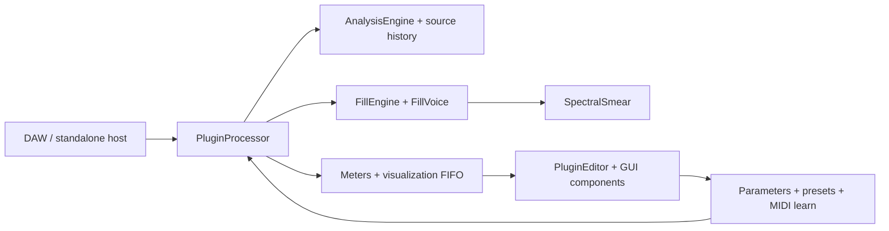

# GapFill module map

Status: as-built file map and maintenance guide, checked against `CMakeLists.txt`, public headers, repository documentation, and the source tree on 2026-10-21. This is a boundary map, not a claim that every implementation path has received a full code review. Update it whenever ownership or dependencies change.

## Runtime flow

The processor is the host boundary and coordinator. Analysis, fill scheduling, voice rendering, and UI display communicate through bounded state/events. Treat the diagram as a dependency guide; the implementation is the source of truth.

## Current source ownership

| Area | Current files | Responsibility and contract |
|---|---|---|
| Host processor / state | `Source/PluginProcessor.h/.cpp` | JUCE processor lifecycle, buses, parameter state, prepare/release, process-block/chunk orchestration, transport/PDC, bypass, preset/file state and editor-facing accessors. Keep orchestration thin; audio work is bounded and real-time safe. |
| Parameter catalog | `Source/Parameters.h/.cpp`, `Source/params/*` | `Parameters.h` holds the core IDs (`GAPFILL_PARAMS_CORE`) and chains the permanent group list; each feature group has `params/<group>.h` (X-macro IDs), `params/<group>.cpp` (layout builder + Random/Undo classification) and `tools/param_ids/<group>.lock`. IDs are public compatibility data: append only; `tools/validate_repo.py` enforces locks, spelling, uniqueness and group order. |
| Factory presets | `Source/Presets.h/.cpp` | Factory state values by parameter ID. Every referenced ID must exist and every preset must stay valid under state migration. |
| Analysis | `Source/dsp/AnalysisEngine.h/.cpp`, `Source/dsp/DspUtils.h` | Input/sidechain signal analysis and shared DSP utilities. Analysis output must be finite, bounded, and safe when the sidechain is absent or silent. |
| Source history | Owned by `PluginProcessor`; buffer implementation is in the processor/DSP sources | Bounded recent-input audio used to construct fills. Allocate/resize only in preparation paths; process callbacks must not read unwritten samples. |
| Fill scheduling / recipes | `Source/dsp/FillEngine.h/.cpp`, `SchedulerTypes.h/.cpp`, `FillRecipe.h`, `EngineSettings.h` | `trySchedule` orchestrates `checkEligibility -> rollDecision -> buildRecipe -> adjustRecipe (hook) -> toVoiceSetup -> startVoice`; every rejection carries a `RejectReason`. The legacy `Rng` draw order is frozen; features use salted sub-RNGs (`features/Salts.h`). `FillRecipe` is a 16-byte POD of the decisions taken. Decisions are reproducible and independent of host callback chunking (test: `fill_start_positions_are_independent_of_host_block_size`). |
| Fill voice | `Source/dsp/FillVoice.h/.cpp` | Renders scheduled wet fill material. Voice count and per-voice memory are bounded; protection must preserve important input transients. |
| Spectral processing | `Source/dsp/SpectralSmear.h/.cpp` | Shared spectral smear/time-frequency processing used by the fill voice. Plans and buffers are prepared before processing; CPU and memory remain bounded. |
| MIDI learn | `Source/MidiLearn.h/.cpp` | Incoming CC-to-parameter mapping, learn timeout/cancel/conflict handling, and persistence. It must not emit MIDI or block the audio callback. |
| Editor coordinator | `Source/PluginEditor.h/.cpp` | Creates panels, global actions, tabs, preset/file commands, status/latency displays, timer refresh, and editor preferences. Keep DSP decisions out of the editor. |
| Visualizer | `Source/gui/WaveformGapView.h/.cpp`, `Source/dsp/VisualisationState.h` | Reads bounded display data and paints the activity/gap view. UI sampling/painting may drop display frames; it must never affect sound. |
| Panels and controls | `Source/gui/Panels.h/.cpp`, `Source/gui/Knob.h/.cpp`, `Source/gui/LookAndFeel.h/.cpp` | Parameter-backed controls, layout, painting, accessibility labels, and theme. Components observe parameter state; they do not own audio-engine state. |
| Help / options | `Source/gui/HelpView.*`, `HelpRegistry.*`, `HelpSections.cpp`, `OptionsView.*` | `HelpView` renders whatever `HelpRegistry` holds; core text is registered in `HelpSections.cpp` (orders 100-990, 9000+), features register at 1000-8999. Options: non-automatable editor preferences. |
| Tests | `Tests/TestFramework.*`, `TestDsp.cpp`, `TestPlugin.cpp` (frozen), `TestCombinatorial.cpp`, `TestSignals.*`, `Tests/support/*`, `Tests/features/*`, `Tests/Perf.cpp`, `Tests/golden`, `Tests/fixtures` | Custom registry; `TestRig` (offline render, `drumLoop`), `AllocGuard` (per-thread allocation counter); golden renders per platform; 0.0.1 state fixtures; one `Tests/features/Test<Feature>.cpp` per feature. `GapFillTests --write-golden` / `tools/dev/write_golden.sh` rewrite baselines (only in a `[golden]` PR). |
| Build composition | `CMakeLists.txt`, `cmake/sources/*.cmake`, `cmake/tests/*.cmake`, `.github/workflows/ci.yml` | `CMakeLists.txt` is frozen: it includes one fragment per feature (explicit file lists; `file(GLOB)` only over the fragment directories). A new source file goes in the owning feature's fragment, which then applies to the plugin and the test target. |

## Ownership and thread boundaries

| Resource | Owner | Cross-thread path | Invariant |
|---|---|---|---|
| APVTS and host parameters | JUCE processor / host | JUCE parameter callbacks and atomic parameter cache | Parameter IDs and normalized/ranged conversions remain stable. Never let GUI-only preferences become automatable by accident. |
| Analysis, source history, voices | Processor and DSP engine | Audio callback only, except prepared configuration | Fixed capacity after `prepareToPlay`; no locks, allocations, file I/O, or logging in processing. |
| MIDI learn mapping | MIDI learn manager | MIDI input + bounded message-thread status updates | Mapping changes are deterministic, bounded, and serialized with plugin state. |
| Meter/visualization snapshots | Processor | Atomics/FIFO to editor timer | UI may miss frames; audio state and decisions cannot wait for the editor. |
| Preset/file chooser state | Editor/message thread | Validated state handoff to processor | File parsing is size-limited and atomic; a bad file leaves current sound unchanged. |
| Editor components | Editor/message thread | Reads snapshots and parameter attachments | Host may destroy/recreate editor at any time while audio processing continues. |

## Dependency rules

1. Dependency direction is UI → processor-facing APIs → DSP; DSP MUST NOT depend on GUI classes.
2. Prefer small data-transfer structs and explicit commands/events over direct cross-thread callbacks.
3. New feature state belongs to the feature/module that owns the behavior. Processor state is limited to routing, lifecycle, and stable integration hooks.
4. Avoid new global mutable state and circular includes. Keep registries explicit and append-only where IDs are compatibility data.
5. Add source and test files explicitly to the owning `cmake/sources/<feature>.cmake` / `cmake/tests/<feature>.cmake` fragment. Do not glob source directories.
6. Before moving code, establish behavior with a focused test and golden comparison; after moving code, run the full relevant test group and host validators.

## Current seams and refactor targets

The repository is functionally organized but still uses broad coordinator files (`PluginProcessor.cpp`, `PluginEditor.cpp`, and `Panels.cpp`). The stabilization backlog proposes narrower feature modules. Extract only when a change has a clear owner and tests:

- Split processor transport/state/preset concerns from audio callback orchestration.
- Isolate scheduler stages and recipe decisions behind the existing `FillEngine` contract.
- Keep analysis results and rejection reasons in fixed-size event records for GUI explanation.
- Add GUI panels as registered slot components instead of expanding editor conditionals.
- Keep each new effect in its own DSP module and test target; effect modules must be callable from fill recipes without introducing editor dependencies.

## Phase 0 seams (docs/dev/02-FOUNDATIONS.md, docs/dev/12 F0-10)

Each seam is a contract for later feature work. A feature adds files and edits only the rows named below; it does not edit hot files (`tools/check_hot_files.py`).

| Seam | Files | Contract / how a feature plugs in | Errors / invariants |
|---|---|---|---|
| Parameter groups | `Source/params/<group>.h/.cpp`, `tools/param_ids/<group>.lock`, `tools/param_ids/GROUP_ORDER`, `cmake/sources/params.cmake` | 41 permanent groups (core + 11 named in 02 + 30 from doc 12), all empty. Add `X (member, "id")` entries to the group header, the parameter in `add<Group>Parameters`, the id to the lock, and classify performance state in `add<Group>PerformanceIds`. | Index order = group order = permanent. IDs `^[a-z][A-Za-z0-9]*$`, unique, append-only. Defaults neutral. |
| Scheduler stages | `Source/dsp/FillEngine.cpp`, `SchedulerTypes.h` | The stage a ticket owns is edited alone: `adjustRecipe` (Lock C-5, Mistakes C-3), `buildRecipe`, `rollDecision`, `checkEligibility`. Reject with a `RejectReason` instead of `return false`. | RNG draws on `rng` frozen; new randomness via `Rng sub; sub.seed (hashCombine (ctx.key, kSalt_X))`. |
| Recipe | `Source/dsp/FillRecipe.h`, `VoiceSetup::modifierOverride/pitchOverride` | 16-byte POD with `isValid`, `toBytes/fromBytes`. A recipe flagged `flagFromLock` forces modifiers/pitch in `toVoiceSetup`. | Overrides neutral by default (0xFF / 127). |
| Queues | `Source/dsp/SpscQueue.h`, `EngineEvents.h`, `EventLogs.h`; processor `postCommand`, `drainFillEvents`, `getRecipeHistory`, `getGapOutcomeLog` | Message thread posts `Command`s (ids 1-30 permanent); `hooks::dispatchCommand` (FeatureHooks.cpp) handles them on the audio thread once per block. Audio thread pushes `FillEvent`s; the 15 Hz timer fills `RecipeHistory` (8) and `GapOutcomeLog` (64). | Single producer per queue; full `fillEvents` drops newest and counts; rejections only while the visualiser is enabled. |
| Effective settings | `Source/features/effective/Effective.*`, `Stage<Feature>.cpp`, `FeatureHooks.*` | Block stage `applyPersonality -> applyMacros`; decision stage `applyEvolve -> applyBreathing -> applyPhrase` on the scheduler's local copy. Features read their params in a `gather<Feature>` line in `FeatureHooks.cpp` and fill `EngineSettings::perf`. | Each stage is the identity at neutral settings (`memcmp` test). |
| State | `Source/features/state/StateSubtrees.*` | One row per subtree (`Macros Lock History Perf Scenes Cmd Tension Groove Fx Health Learn`) with caps (total 64 KiB): supply `validate/apply/serialise/reset`. `stateVersion` 2 written; `migrate` exists for v3. | Parameters validated atomically as before; a bad optional subtree is dropped and reset, the rest loads. Never serialise audio, momentary or preview state. |
| Editor slots | `Source/gui/SlotHost.*`, `Source/gui/slots/*.cpp` | `static SlotRegistrar` with `{Slot, order, factory}`; the host owns instances and lays them out (8 px). Reserve the slot's rectangle once in `PluginEditor::resized` (`CreativeExtra`, `VisualiserOverlay`, `FooterStatus` today). | Components receive the processor, own their attachments, never touch audio memory, survive editor re-open. |
| Help | `Source/gui/HelpRegistry.*` | `static HelpRegistrar` with order 1000-8999. | Orders unique and ascending. |
| Tooling | `tools/check_hot_files.py`, `tools/validate_repo.py`, `tools/dev/*`, `.clang-format`, `.clang-tidy` | Hot-file / golden / perf title rules; param lock rules; local gate `tools/dev/check.sh`. | CI preflight runs both Python test suites. |

## Explain & assist (WP3: E-3, F-S01, N-USE-b, N-EASY, F-M03, F-D02)

Sources: `cmake/sources/explain.cmake`; tests: `cmake/tests/explain.cmake`. The processor owns ONE `explain::ExplainState` (`getExplainState()`); everything else reads it.

| Module | Files | Contract | Dependencies / invariants / errors |
|---|---|---|---|
| Reasons (E-3) | `features/reasons/Reasons.*`, `Gui.*` | Pure wording of the engine's `RejectReason` / `FillEvent` (label, advice, numbers, status line, top-3, 4 Hz limiter) and the legend strip (colour + pattern + text, collapsible). | Depends only on `EngineEvents.h`; never recomputes a reason. Out-of-range reason -> "Unknown reason". The engine side lives in `FillEngine::controlUpdate` (sets `VizFrame::flagRejected/reason/availMs/needMs`) and `WaveformGapView` (threshold line `kEnterGapConf`, hollow markers, hover tooltip). |
| Telemetry (F-S01) | `features/telemetry/Telemetry.*` | `CpuMeter`: EMA (0.5 s time constant) of processBlock time / block duration; `formatLatency/formatCpu/describeTelemetry` (always "estimated"). | Audio thread: two tick reads per block, only while an editor is open (`viz.isEnabled()`); disabled = one atomic load. Garbage input ignored. Per-card `fxCpu` arrives with FX-0. |
| Health (N-USE-b) | `features/health/Health.*`, `Gui.*` | `HealthMonitor` (audio thread) -> one `atomic<uint32>` mask with set/clear hysteresis; `HealthTracker` (message thread) onset times; `describe`, `priorityOrder`, `highestVisible`, `selectFooter`; footer component + detail panel. | Codes are permanent bit positions. `PanicActive`/`OverloadCritical` cannot be muted. `FreeTimingFallback` (E-2) and `PanicActive` (N-USE-a) inputs exist but are not wired until those tickets land. Muted codes persist in the `Health` subtree. |
| Fix-it (N-EASY) | `features/fixit/Fixit.*` | 13 permanent rules over `Evidence` (last 8 gaps + health), `Controller` (hold 4 s, show >= 6 s, 5 min cooldown, Apply = one undo snapshot + `begin/set/endChangeGesture`, Undo restores exact normalised values unless edited since). | Message thread only, no audio-thread includes; writes only whitelisted parameters (`isAllowedParameter`); a rule whose parameter does not exist (`fillLock`, `qualityMode` today) is inactive. R10 needs an explicit confirm. |
| Timeline (F-M03) | `features/timeline/Model.*`, `Gui.*` | `TimelineEvent` (32 B), `TimelineModel` (512 ring, fed from `fillEvents`), `TimelineView` + text list. Engine events `Onset/GapOpen/FillEnd` use `FillEventQueue::pushOptional` (never take the last 16 slots), so outcomes are never displaced. | Queue overflow marks the view incomplete (striped cap). Reduced Motion: 4 Hz redraw. Reserved `FillEventType` values 6-9 belong to E-1 / F-L07 / N-USE-a. |
| Events (F-D02) | `features/events/EventRecorder.*`, `Replay.*`, `Diagnostics.*` | 24-byte records, one audio-thread producer into a 65,536-slot ring, bounded store (60,000 records), `.gfevents` text <= 2 MiB (hostile input validated), `replay()` harness. Attached through `FillEventQueue::setTap`. | Off = one atomic load per hook. Full = recording stops and says so. Never audio, never paths. Command 29 raises a flag; the timer toggles (starting allocates). |
| Integration | `features/explain/ExplainState.*`, `OverlaySlot.*`, `Help.cpp` | The four processor calls (`BlockTimer`, `onChunk`, `onCommand`, `onFillEvent/timerTick`), the `Health` state subtree (muted codes/rules, suggestions, legend, zoom), one composite component for `VisualiserOverlay`, one for `FooterStatus`, help section order 3000. | `Health` subtree: validate-then-apply, defaults write nothing, 1 KiB cap. |

Hot-file edits made for WP3 (all minimal, listed in `docs/progress/WP3.md`): `PluginProcessor.cpp/.h` (member + 8 call lines), `FillEngine.cpp/.h` (timeline events, reject flags in the viz frame), `PluginEditor.cpp` (footer height, `openOptions` wiring), plus `EngineEvents.h`, `VisualisationState.h`, `WaveformGapView.*`, `StateSubtrees.cpp` (the `Health` row).

Migration notes: `GAPFILL_PARAMS` is now the core list plus the group chain; the expanded macro yields the same 66 core parameters in the same order. Old (v1) states and presets load unchanged; fixtures `Tests/fixtures/state_0.0.1_*.bin` and goldens in `Tests/golden/linux` prove it.

## Voice effects (WP8: FX-0, N-FX1, N-FX2, F-M16, F-M14, F-M20, F-L14)

| Module | Files | Contract / dependencies | Invariants and errors |
|---|---|---|---|
| Effect-card framework | `Source/features/fx/EffectCard.h`, `FxSettings.h`, `FxMeters.h`, `EngineBlockIO.h` | `VoiceFx` (per voice, `processVoice`) and `BusFx` (wet bus, `processBus`) cards; `CardId` is the permanent chain order and the `FxMeters::cpu*` index. `FxSettings` is the plain-data snapshot of every effect parameter (neutral = Amount 0). Depends on `FillRecipe` only. | An Amount below 0.001 is off and the card is never called. Cards allocate in `prepare` only. Chain output is sanitised and capped at +12 dBFS. |
| Voice chain | `VoiceFxChain.*`, `RatchetCard.*`, `TapeDestrCard.*`, `RcrushCard.*` | `FillVoice` owns one chain. `start()` latches the settings (`VoiceSetup::fxStart`); fills with no active card take the original direct path (bit-identical output). Duck and panic fade are applied after the cards. New card = new files + one line in `VoiceFxChain::build()`. | Settings are latched per fill: no mid-fill change, independent of host block size. A 1.5 ms end guard prevents a step when a delaying card meets the voice end. |
| Bus chain | `FxChain.*` | Processor-owned. `beginBlock -> engine.process(io) -> processBus` before wet post-processing. Publishes the engine duck and the fills started in the block only while a bus card is active. F-L14: a second preallocated stereo bus is used only when a band has effects off and a bus card is active. No bus cards exist until WP9 (`addBusCard`/`build()`). | With no bus card the chain is the identity. A bus card must be delay-compensated by its own `latencySamples`; reported host latency is unchanged. |
| Render modes | `Source/features/swell/SwellMode.*`, `Source/features/cloud/CloudMode.*` | Modes of `Algo::Reverse` / `Algo::Granular` selected by recipe flags bit3 / bit4 (sub-RNGs `kSalt_Swell`, `kSalt_Cloud`). `FillVoice` calls them from three hook lines. Planning (landing, rate, density limit) is in pure functions. | Swell never outlives `landing + fade <= gap`. Cloud has at most 48 grains, estimated overlap <= 40. Neither draws from the legacy scheduler RNG. |
| Engine glue | `Source/features/fx/FxHooks.*`; hook lines in `FeatureHooks.cpp`, `FillEngine.cpp`, `FillVoice.cpp`, `PluginProcessor.*` | `gatherFx` (settings), `decideRenderModes` (adjustRecipe stage), `prepareVoiceSetup` (toVoiceSetup stage: latch settings, swell landing, band routing). | Locked recipes keep the flags they were recorded with. |
| `<Fx>` state and GUI | `FxUiState.*`, `Source/gui/slots/EffectsSection.*` | `<Fx>` subtree (fold state, remembered amounts, <= 1 KiB) in the reserved table; `EffectsSection` registers in `Slot::EffectsSection` and appears when UI-0 reserves that rectangle. Help sections 4000-4060. | A default state writes no `<Fx>` subtree; a damaged one is dropped without affecting parameters. |
| Parameters | `Source/params/{swell,cloud,ratchet,rcrush,tapedestr,bandfx}.*`, `tools/param_ids/*.lock` | 30 permanent IDs (swell 4, cloud 7, ratchet 5, rcrush 5, tapedestr 6, bandfx 3; `scrub` is added with F-M19), append-only. | Defaults are neutral (Amount 0, band effects on). Not part of Random / Surprise. |

Migration notes: states and presets saved before WP8 load unchanged (new parameters take their neutral defaults; no `<Fx>` subtree). Tests that enumerated the 66 core parameters now check the first 66 IDs only.

## Musical context (WP7: N-MUS, F-L22, F-L09, F-X03)

Sources: `cmake/sources/scale.cmake` (N-MUS + F-L22) and `cmake/sources/groove.cmake` (F-L09 + F-X03 + glue); tests: `cmake/tests/scale.cmake`, `groove.cmake`. The processor owns ONE `context::ContextState` (`getContextState()`); it is fed once per chunk after the engine settings are gathered.

| Module | Files | Contract | Dependencies / invariants / errors |
|---|---|---|---|
| Scale Lock (N-MUS) | `features/scale/ScaleLock.*` (pure), `VoiceQuantiser.h`, `ScaleHooks.*`, params `scale.*` | `snapInterval` (relative shifts: nearest in-key interval around the tonic or a supplied pitch class, ties to smaller \|i\| then up, 0 and octaves always allowed), `snapFrequency` (absolute, exact ET note), `snapRatio` (Granular). `decidePitch` (adjustRecipe stage) draws Pitch Rise/Fall semitones from the salted sub-RNG, snaps with probability `scaleAmount` and stores `FillRecipe::pitchSemis` (`flagSnapped`); `prepareVoiceSetup` hands the scale to the voice. `FillVoice` owns a `VoiceQuantiser` (Granular ratios, Comb frequency, Cloud pitch via `CloudPitchQuantiser`). | Off / Amount 0 is the identity (no draw, no write). Legacy RNG draw order untouched. Hot-file lines: 2 in `FillEngine.cpp`, 4 in `FillVoice.cpp`. |
| Context state | `features/context/ContextState.*`, `ContextHooks.*` | `onChunk(mono, n, analysis, inputStart, settings)` runs the F-L09 groove tracker, the F-X03 detector and the F-L22 tracker and publishes their results into `EngineSettings` (`perf.energy`, `perf.groove`, `scaleLock` via the key resolver). `context::prepareVoiceSetup` (one line in `toVoiceSetup`) = Scale Lock voice setup + groove shifts. | Audio thread only; features idle at one comparison while off. Commands 26/27 reach it through `onCommand`. |
| Energy (F-L22) | `features/context/EnergyTracker.*`, `effective/StageEnergy.cpp`, `gui/slots/EnergyStrip.cpp`, params `energy.*` | 0.5 s sample-count frames (RMS dB, onsets/s), adaptive 5-95 % range over 60 s with minimum spans, asymmetric EMA, Low/Mid/High with +-0.05 hysteresis, 2-frame confirm and 4 s dwell; first 10 s neutral. Decision stage `applyEnergy`: density {+0.15,0,-0.15}, intensity {-0.10,0,+0.15} x Follow, by target. | Silence is Low. No per-sample work while Follow = 0. Block-size and sample-rate independent. |
| Groove (F-L09) | `features/groove/GrooveTracker.*`, `GrooveWarp.*`, `GrooveState.*`, `GrooveStateTree.*`, `gui/slots/GrooveStrip.cpp`, params `groove.*` | Slot means of the hits' offsets from the host PPQ grid (8 slots, 1/8 or 1/16), confidence gate 0.35, periodic piecewise-linear warp (slope <= 0.7) turned into per-fill shifts of Stutter repeat / Delay tap boundaries (`VoiceSetup::grooveShifts`, fill start never moves). Event time is taken in the INPUT domain from the analysis events, so lookahead latency needs no correction. `<Groove>` subtree stores a held / learned groove. | Needs valid transport and Sync; otherwise offsets 0. Learn = 8 bars then hold; Reset forgets. Snapshot is published through a seqlock. Scramble slices are not shifted (not a musical subdivision). |
| Key detection (F-X03) | `features/keydetect/ChromaTracker.*`, `KeyEstimator.*`, `AutoKey.*`, `KeyStateTree.*`, `gui/slots/KeyStrip.cpp`, params `keydet.*` | Decimated 4096-point STFT, tonality-gated peak chroma, leaky accumulation, Krumhansl-Kessler correlation for 24 keys, confidence from the gap to the second key and the tonal mass, 3-evaluation hysteresis. `resolveKey`: manual, detected or held. `<Key>` subtree = warm start. | Inactive (Auto key off) means no FFT. One FFT per ~170 ms hop, no allocation. "Not detected" for drums, noise and silence. |

Parameters added: `scaleRoot scaleType scaleAmount` | `scaleFollow fx03_window fx03_minConf fx03_hold` | `energyAdapt energyTarget` | `fl09_amount fl09_grid fl09_hold` (groove IDs are performance ids). New state row `Key` (12 rows now). Migration: old states load with every new feature off.

## Change checklist

- [ ] Update the ownership table and flow diagram if a boundary moves.
- [ ] State which thread owns each new mutable object and how data crosses threads.
- [ ] Add an invariant and an error/overflow policy.
- [ ] Add focused tests before or with the extraction; include neutral-output/golden checks.
- [ ] Update `CMakeLists.txt`, developer setup and feature-to-test traceability.
- [ ] Run preflight, focused tests, full suite, plugin validators and applicable real-host checks.
