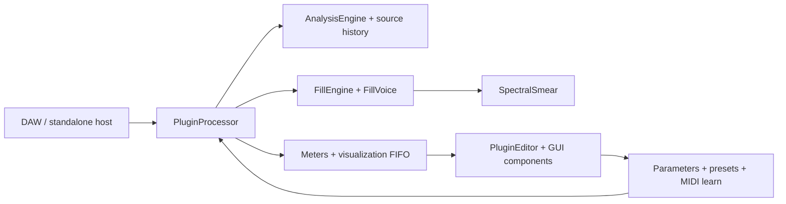

# GapFill module map

Status: as-built file map and maintenance guide, checked against `CMakeLists.txt`, public headers, repository documentation, and the source tree on 2026-10-21. This is a boundary map, not a claim that every implementation path has received a full code review. Update it whenever ownership or dependencies change.

## Runtime flow

The processor is the host boundary and coordinator. Analysis, fill scheduling, voice rendering, and UI display communicate through bounded state/events. Treat the diagram as a dependency guide; the implementation is the source of truth.

## Current source ownership

| Area | Current files | Responsibility and contract |
|---|---|---|
| Host processor / state | `Source/PluginProcessor.h/.cpp` | JUCE processor lifecycle, buses, parameter state, prepare/release, process-block/chunk orchestration, transport/PDC, bypass, preset/file state and editor-facing accessors. Keep orchestration thin; audio work is bounded and real-time safe. |
| Parameter catalog | `Source/Parameters.h/.cpp` | Stable host parameter IDs, ranges, defaults, and parameter groups. IDs are public compatibility data: append new IDs; never repurpose an existing ID. |
| Factory presets | `Source/Presets.h/.cpp` | Factory state values by parameter ID. Every referenced ID must exist and every preset must stay valid under state migration. |
| Analysis | `Source/dsp/AnalysisEngine.h/.cpp`, `Source/dsp/DspUtils.h` | Input/sidechain signal analysis and shared DSP utilities. Analysis output must be finite, bounded, and safe when the sidechain is absent or silent. |
| Source history | Owned by `PluginProcessor`; buffer implementation is in the processor/DSP sources | Bounded recent-input audio used to construct fills. Allocate/resize only in preparation paths; process callbacks must not read unwritten samples. |
| Fill scheduling / recipes | `Source/dsp/FillEngine.h/.cpp` | Eligibility, deterministic choices, gap timing, voice scheduling, and event/reason production. Decisions must be reproducible and independent of host callback chunking. |
| Fill voice | `Source/dsp/FillVoice.h/.cpp` | Renders scheduled wet fill material. Voice count and per-voice memory are bounded; protection must preserve important input transients. |
| Spectral processing | `Source/dsp/SpectralSmear.h/.cpp` | Shared spectral smear/time-frequency processing used by the fill voice. Plans and buffers are prepared before processing; CPU and memory remain bounded. |
| MIDI learn | `Source/MidiLearn.h/.cpp` | Incoming CC-to-parameter mapping, learn timeout/cancel/conflict handling, and persistence. It must not emit MIDI or block the audio callback. |
| Editor coordinator | `Source/PluginEditor.h/.cpp` | Creates panels, global actions, tabs, preset/file commands, status/latency displays, timer refresh, and editor preferences. Keep DSP decisions out of the editor. |
| Visualizer | `Source/gui/WaveformGapView.h/.cpp`, `Source/dsp/VisualisationState.h` | Reads bounded display data and paints the activity/gap view. UI sampling/painting may drop display frames; it must never affect sound. |
| Panels and controls | `Source/gui/Panels.h/.cpp`, `Source/gui/Knob.h/.cpp`, `Source/gui/LookAndFeel.h/.cpp` | Parameter-backed controls, layout, painting, accessibility labels, and theme. Components observe parameter state; they do not own audio-engine state. |
| Help / options | `Source/gui/HelpView.h/.cpp`, `Source/gui/OptionsView.h/.cpp` | User help and non-automatable editor preferences such as tooltips, keyboard navigation, and reduced motion. |
| Tests | `Tests/TestFramework.*`, `TestDsp.cpp`, `TestPlugin.cpp`, `TestCombinatorial.cpp`, `TestSignals.*` | Custom test registry, DSP fixtures, plugin/state/UI checks, and parameter-space sweeps. New tests must be registered and must fail if a requested filter executes zero tests. |
| Build composition | `CMakeLists.txt`, `.github/workflows/ci.yml` | Explicit production/test source list, dependencies, plugin formats, compile settings, and CI validation jobs. A new source file must be added to every applicable target. |

## Ownership and thread boundaries

| Resource | Owner | Cross-thread path | Invariant |
|---|---|---|---|
| APVTS and host parameters | JUCE processor / host | JUCE parameter callbacks and atomic parameter cache | Parameter IDs and normalized/ranged conversions remain stable. Never let GUI-only preferences become automatable by accident. |
| Analysis, source history, voices | Processor and DSP engine | Audio callback only, except prepared configuration | Fixed capacity after `prepareToPlay`; no locks, allocations, file I/O, or logging in processing. |
| MIDI learn mapping | MIDI learn manager | MIDI input + bounded message-thread status updates | Mapping changes are deterministic, bounded, and serialized with plugin state. |
| Meter/visualization snapshots | Processor | Atomics/FIFO to editor timer | UI may miss frames; audio state and decisions cannot wait for the editor. |
| Preset/file chooser state | Editor/message thread | Validated state handoff to processor | File parsing is size-limited and atomic; a bad file leaves current sound unchanged. |
| Editor components | Editor/message thread | Reads snapshots and parameter attachments | Host may destroy/recreate editor at any time while audio processing continues. |

## Dependency rules

1. Dependency direction is UI → processor-facing APIs → DSP; DSP MUST NOT depend on GUI classes.
2. Prefer small data-transfer structs and explicit commands/events over direct cross-thread callbacks.
3. New feature state belongs to the feature/module that owns the behavior. Processor state is limited to routing, lifecycle, and stable integration hooks.
4. Avoid new global mutable state and circular includes. Keep registries explicit and append-only where IDs are compatibility data.
5. Add source and test files explicitly to CMake. Do not use broad filesystem globs that make builds depend on directory contents.
6. Before moving code, establish behavior with a focused test and golden comparison; after moving code, run the full relevant test group and host validators.

## Current seams and refactor targets

The repository is functionally organized but still uses broad coordinator files (`PluginProcessor.cpp`, `PluginEditor.cpp`, and `Panels.cpp`). The stabilization backlog proposes narrower feature modules. Extract only when a change has a clear owner and tests:

- Split processor transport/state/preset concerns from audio callback orchestration.
- Isolate scheduler stages and recipe decisions behind the existing `FillEngine` contract.
- Keep analysis results and rejection reasons in fixed-size event records for GUI explanation.
- Add GUI panels as registered slot components instead of expanding editor conditionals.
- Keep each new effect in its own DSP module and test target; effect modules must be callable from fill recipes without introducing editor dependencies.

## Change checklist

- [ ] Update the ownership table and flow diagram if a boundary moves.
- [ ] State which thread owns each new mutable object and how data crosses threads.
- [ ] Add an invariant and an error/overflow policy.
- [ ] Add focused tests before or with the extraction; include neutral-output/golden checks.
- [ ] Update `CMakeLists.txt`, developer setup and feature-to-test traceability.
- [ ] Run preflight, focused tests, full suite, plugin validators and applicable real-host checks.
