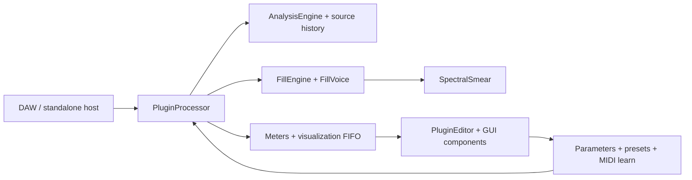

# GapFill module map

Status: as-built file map and maintenance guide, checked against `CMakeLists.txt`, public headers, repository documentation, and the source tree on 2026-10-21. This is a boundary map, not a claim that every implementation path has received a full code review. Update it whenever ownership or dependencies change.

## Runtime flow

The processor is the host boundary and coordinator. Analysis, fill scheduling, voice rendering, and UI display communicate through bounded state/events. Treat the diagram as a dependency guide; the implementation is the source of truth.

## Current source ownership

| Area | Current files | Responsibility and contract |
|---|---|---|
| Host processor / state | `Source/PluginProcessor.h/.cpp` | JUCE processor lifecycle, buses, parameter state, prepare/release, process-block/chunk orchestration, transport/PDC, bypass, preset/file state and editor-facing accessors. Keep orchestration thin; audio work is bounded and real-time safe. |
| Parameter catalog | `Source/Parameters.h/.cpp`, `Source/params/*` | `Parameters.h` holds the core IDs (`GAPFILL_PARAMS_CORE`) and chains the permanent group list; each feature group has `params/<group>.h` (X-macro IDs), `params/<group>.cpp` (layout builder + Random/Undo classification) and `tools/param_ids/<group>.lock`. IDs are public compatibility data: append only; `tools/validate_repo.py` enforces locks, spelling, uniqueness and group order. |
| Factory presets | `Source/Presets.h/.cpp` | Factory state values by parameter ID. Every referenced ID must exist and every preset must stay valid under state migration. |
| Analysis | `Source/dsp/AnalysisEngine.h/.cpp`, `Source/dsp/DspUtils.h` | Input/sidechain signal analysis and shared DSP utilities. Analysis output must be finite, bounded, and safe when the sidechain is absent or silent. |
| Source history | Owned by `PluginProcessor`; buffer implementation is in the processor/DSP sources | Bounded recent-input audio used to construct fills. Allocate/resize only in preparation paths; process callbacks must not read unwritten samples. |
| Fill scheduling / recipes | `Source/dsp/FillEngine.h/.cpp`, `SchedulerTypes.h/.cpp`, `FillRecipe.h`, `EngineSettings.h` | `trySchedule` orchestrates `checkEligibility -> rollDecision -> buildRecipe -> adjustRecipe (hook) -> toVoiceSetup -> startVoice`; every rejection carries a `RejectReason`. The legacy `Rng` draw order is frozen; features use salted sub-RNGs (`features/Salts.h`). `FillRecipe` is a 16-byte POD of the decisions taken. Decisions are reproducible and independent of host callback chunking (test: `fill_start_positions_are_independent_of_host_block_size`). |
| Fill voice | `Source/dsp/FillVoice.h/.cpp` | Renders scheduled wet fill material. Voice count and per-voice memory are bounded; protection must preserve important input transients. |
| Spectral processing | `Source/dsp/SpectralSmear.h/.cpp` | Shared spectral smear/time-frequency processing used by the fill voice. Plans and buffers are prepared before processing; CPU and memory remain bounded. |
| MIDI learn | `Source/MidiLearn.h/.cpp` | Incoming CC-to-parameter mapping, learn timeout/cancel/conflict handling, and persistence. It must not emit MIDI or block the audio callback. |
| Editor coordinator | `Source/PluginEditor.h/.cpp` | Creates panels, global actions, tabs, preset/file commands, status/latency displays, timer refresh, and editor preferences. Keep DSP decisions out of the editor. |
| Visualizer | `Source/gui/WaveformGapView.h/.cpp`, `Source/dsp/VisualisationState.h` | Reads bounded display data and paints the activity/gap view. UI sampling/painting may drop display frames; it must never affect sound. |
| Panels and controls | `Source/gui/Panels.h/.cpp`, `Source/gui/Knob.h/.cpp`, `Source/gui/LookAndFeel.h/.cpp` | Parameter-backed controls, layout, painting, accessibility labels, and theme. Components observe parameter state; they do not own audio-engine state. |
| Help / options | `Source/gui/HelpView.*`, `HelpRegistry.*`, `HelpSections.cpp`, `OptionsView.*` | `HelpView` renders whatever `HelpRegistry` holds; core text is registered in `HelpSections.cpp` (orders 100-990, 9000+), features register at 1000-8999. Options: non-automatable editor preferences. |
| Tests | `Tests/TestFramework.*`, `TestDsp.cpp`, `TestPlugin.cpp` (frozen), `TestCombinatorial.cpp`, `TestSignals.*`, `Tests/support/*`, `Tests/features/*`, `Tests/Perf.cpp`, `Tests/golden`, `Tests/fixtures` | Custom registry; `TestRig` (offline render, `drumLoop`), `AllocGuard` (per-thread allocation counter); golden renders per platform; 0.0.1 state fixtures; one `Tests/features/Test<Feature>.cpp` per feature. `GapFillTests --write-golden` / `tools/dev/write_golden.sh` rewrite baselines (only in a `[golden]` PR). |
| Build composition | `CMakeLists.txt`, `cmake/sources/*.cmake`, `cmake/tests/*.cmake`, `.github/workflows/ci.yml` | `CMakeLists.txt` is frozen: it includes one fragment per feature (explicit file lists; `file(GLOB)` only over the fragment directories). A new source file goes in the owning feature's fragment, which then applies to the plugin and the test target. |

## Ownership and thread boundaries

| Resource | Owner | Cross-thread path | Invariant |
|---|---|---|---|
| APVTS and host parameters | JUCE processor / host | JUCE parameter callbacks and atomic parameter cache | Parameter IDs and normalized/ranged conversions remain stable. Never let GUI-only preferences become automatable by accident. |
| Analysis, source history, voices | Processor and DSP engine | Audio callback only, except prepared configuration | Fixed capacity after `prepareToPlay`; no locks, allocations, file I/O, or logging in processing. |
| MIDI learn mapping | MIDI learn manager | MIDI input + bounded message-thread status updates | Mapping changes are deterministic, bounded, and serialized with plugin state. |
| Meter/visualization snapshots | Processor | Atomics/FIFO to editor timer | UI may miss frames; audio state and decisions cannot wait for the editor. |
| Preset/file chooser state | Editor/message thread | Validated state handoff to processor | File parsing is size-limited and atomic; a bad file leaves current sound unchanged. |
| Editor components | Editor/message thread | Reads snapshots and parameter attachments | Host may destroy/recreate editor at any time while audio processing continues. |

## Dependency rules

1. Dependency direction is UI → processor-facing APIs → DSP; DSP MUST NOT depend on GUI classes.
2. Prefer small data-transfer structs and explicit commands/events over direct cross-thread callbacks.
3. New feature state belongs to the feature/module that owns the behavior. Processor state is limited to routing, lifecycle, and stable integration hooks.
4. Avoid new global mutable state and circular includes. Keep registries explicit and append-only where IDs are compatibility data.
5. Add source and test files explicitly to the owning `cmake/sources/<feature>.cmake` / `cmake/tests/<feature>.cmake` fragment. Do not glob source directories.
6. Before moving code, establish behavior with a focused test and golden comparison; after moving code, run the full relevant test group and host validators.

## Current seams and refactor targets

The repository is functionally organized but still uses broad coordinator files (`PluginProcessor.cpp`, `PluginEditor.cpp`, and `Panels.cpp`). The stabilization backlog proposes narrower feature modules. Extract only when a change has a clear owner and tests:

- Split processor transport/state/preset concerns from audio callback orchestration.
- Isolate scheduler stages and recipe decisions behind the existing `FillEngine` contract.
- Keep analysis results and rejection reasons in fixed-size event records for GUI explanation.
- Add GUI panels as registered slot components instead of expanding editor conditionals.
- Keep each new effect in its own DSP module and test target; effect modules must be callable from fill recipes without introducing editor dependencies.

## Phase 0 seams (docs/dev/02-FOUNDATIONS.md, docs/dev/12 F0-10)

Each seam is a contract for later feature work. A feature adds files and edits only the rows named below; it does not edit hot files (`tools/check_hot_files.py`).

| Seam | Files | Contract / how a feature plugs in | Errors / invariants |
|---|---|---|---|
| Parameter groups | `Source/params/<group>.h/.cpp`, `tools/param_ids/<group>.lock`, `tools/param_ids/GROUP_ORDER`, `cmake/sources/params.cmake` | 41 permanent groups (core + 11 named in 02 + 30 from doc 12), all empty. Add `X (member, "id")` entries to the group header, the parameter in `add<Group>Parameters`, the id to the lock, and classify performance state in `add<Group>PerformanceIds`. | Index order = group order = permanent. IDs `^[a-z][A-Za-z0-9]*$`, unique, append-only. Defaults neutral. |
| Scheduler stages | `Source/dsp/FillEngine.cpp`, `SchedulerTypes.h` | The stage a ticket owns is edited alone: `adjustRecipe` (Lock C-5, Mistakes C-3), `buildRecipe`, `rollDecision`, `checkEligibility`. Reject with a `RejectReason` instead of `return false`. | RNG draws on `rng` frozen; new randomness via `Rng sub; sub.seed (hashCombine (ctx.key, kSalt_X))`. |
| Recipe | `Source/dsp/FillRecipe.h`, `VoiceSetup::modifierOverride/pitchOverride` | 16-byte POD with `isValid`, `toBytes/fromBytes`. A recipe flagged `flagFromLock` forces modifiers/pitch in `toVoiceSetup`. | Overrides neutral by default (0xFF / 127). |
| Queues | `Source/dsp/SpscQueue.h`, `EngineEvents.h`, `EventLogs.h`; processor `postCommand`, `drainFillEvents`, `getRecipeHistory`, `getGapOutcomeLog` | Message thread posts `Command`s (ids 1-30 permanent); `hooks::dispatchCommand` (FeatureHooks.cpp) handles them on the audio thread once per block. Audio thread pushes `FillEvent`s; the 15 Hz timer fills `RecipeHistory` (8) and `GapOutcomeLog` (64). | Single producer per queue; full `fillEvents` drops newest and counts; rejections only while the visualiser is enabled. |
| Effective settings | `Source/features/effective/Effective.*`, `Stage<Feature>.cpp`, `FeatureHooks.*` | Block stage `applyPersonality -> applyMacros`; decision stage `applyEvolve -> applyBreathing -> applyPhrase` on the scheduler's local copy. Features read their params in a `gather<Feature>` line in `FeatureHooks.cpp` and fill `EngineSettings::perf`. | Each stage is the identity at neutral settings (`memcmp` test). |
| State | `Source/features/state/StateSubtrees.*` | One row per subtree (`Macros Lock History Perf Scenes Cmd Tension Groove Fx Health Learn`) with caps (total 64 KiB): supply `validate/apply/serialise/reset`. `stateVersion` 2 written; `migrate` exists for v3. | Parameters validated atomically as before; a bad optional subtree is dropped and reset, the rest loads. Never serialise audio, momentary or preview state. |
| Editor slots | `Source/gui/SlotHost.*`, `Source/gui/slots/*.cpp` | `static SlotRegistrar` with `{Slot, order, factory}`; the host owns instances and lays them out (8 px). Reserve the slot's rectangle once in `PluginEditor::resized` (`CreativeExtra`, `VisualiserOverlay`, `FooterStatus` today). | Components receive the processor, own their attachments, never touch audio memory, survive editor re-open. |
| Help | `Source/gui/HelpRegistry.*` | `static HelpRegistrar` with order 1000-8999. | Orders unique and ascending. |
| Tooling | `tools/check_hot_files.py`, `tools/validate_repo.py`, `tools/dev/*`, `.clang-format`, `.clang-tidy` | Hot-file / golden / perf title rules; param lock rules; local gate `tools/dev/check.sh`. | CI preflight runs both Python test suites. |

## Explain & assist (WP3: E-3, F-S01, N-USE-b, N-EASY, F-M03, F-D02)

Sources: `cmake/sources/explain.cmake`; tests: `cmake/tests/explain.cmake`. The processor owns ONE `explain::ExplainState` (`getExplainState()`); everything else reads it.

| Module | Files | Contract | Dependencies / invariants / errors |
|---|---|---|---|
| Reasons (E-3) | `features/reasons/Reasons.*`, `Gui.*` | Pure wording of the engine's `RejectReason` / `FillEvent` (label, advice, numbers, status line, top-3, 4 Hz limiter) and the legend strip (colour + pattern + text, collapsible). | Depends only on `EngineEvents.h`; never recomputes a reason. Out-of-range reason -> "Unknown reason". The engine side lives in `FillEngine::controlUpdate` (sets `VizFrame::flagRejected/reason/availMs/needMs`) and `WaveformGapView` (threshold line `kEnterGapConf`, hollow markers, hover tooltip). |
| Telemetry (F-S01) | `features/telemetry/Telemetry.*` | `CpuMeter`: EMA (0.5 s time constant) of processBlock time / block duration; `formatLatency/formatCpu/describeTelemetry` (always "estimated"). | Audio thread: two tick reads per block, only while an editor is open (`viz.isEnabled()`); disabled = one atomic load. Garbage input ignored. Per-card `fxCpu` arrives with FX-0. |
| Health (N-USE-b) | `features/health/Health.*`, `Gui.*` | `HealthMonitor` (audio thread) -> one `atomic<uint32>` mask with set/clear hysteresis; `HealthTracker` (message thread) onset times; `describe`, `priorityOrder`, `highestVisible`, `selectFooter`; footer component + detail panel. | Codes are permanent bit positions. `PanicActive`/`OverloadCritical` cannot be muted. `FreeTimingFallback` (E-2) and `PanicActive` (N-USE-a) inputs exist but are not wired until those tickets land. Muted codes persist in the `Health` subtree. |
| Fix-it (N-EASY) | `features/fixit/Fixit.*` | 13 permanent rules over `Evidence` (last 8 gaps + health), `Controller` (hold 4 s, show >= 6 s, 5 min cooldown, Apply = one undo snapshot + `begin/set/endChangeGesture`, Undo restores exact normalised values unless edited since). | Message thread only, no audio-thread includes; writes only whitelisted parameters (`isAllowedParameter`); a rule whose parameter does not exist (`fl01_lock`, `qualityMode` today) is inactive. R10 needs an explicit confirm. |
| Timeline (F-M03) | `features/timeline/Model.*`, `Gui.*` | `TimelineEvent` (32 B), `TimelineModel` (512 ring, fed from `fillEvents`), `TimelineView` + text list. Engine events `Onset/GapOpen/FillEnd` use `FillEventQueue::pushOptional` (never take the last 16 slots), so outcomes are never displaced. | Queue overflow marks the view incomplete (striped cap). Reduced Motion: 4 Hz redraw. Reserved `FillEventType` values 6-9 belong to E-1 / F-L07 / N-USE-a. |
| Events (F-D02) | `features/events/EventRecorder.*`, `Replay.*`, `Diagnostics.*` | 24-byte records, one audio-thread producer into a 65,536-slot ring, bounded store (60,000 records), `.gfevents` text <= 2 MiB (hostile input validated), `replay()` harness. Attached through `FillEventQueue::setTap`. | Off = one atomic load per hook. Full = recording stops and says so. Never audio, never paths. Command 29 raises a flag; the timer toggles (starting allocates). |
| Integration | `features/explain/ExplainState.*`, `OverlaySlot.*`, `Help.cpp` | The four processor calls (`BlockTimer`, `onChunk`, `onCommand`, `onFillEvent/timerTick`), the `Health` state subtree (muted codes/rules, suggestions, legend, zoom), one composite component for `VisualiserOverlay`, one for `FooterStatus`, help section order 3000. | `Health` subtree: validate-then-apply, defaults write nothing, 1 KiB cap. |

Hot-file edits made for WP3 (all minimal, listed in `docs/progress/WP3.md`): `PluginProcessor.cpp/.h` (member + 8 call lines), `FillEngine.cpp/.h` (timeline events, reject flags in the viz frame), `PluginEditor.cpp` (footer height, `openOptions` wiring), plus `EngineEvents.h`, `VisualisationState.h`, `WaveformGapView.*`, `StateSubtrees.cpp` (the `Health` row).

Migration notes: `GAPFILL_PARAMS` is now the core list plus the group chain; the expanded macro yields the same 66 core parameters in the same order. Old (v1) states and presets load unchanged; fixtures `Tests/fixtures/state_0.0.1_*.bin` and goldens in `Tests/golden/linux` prove it.

## WP4 recipe features (E-1, U-3, C-5, U-1, C-11, U-2, F-S06)

One facade (`features/recipes/RecipeServices`) is held by the processor; every feature keeps its logic in its own directory and plugs in through the Phase 0 seams. Parameters: only `fl01_lock` (group `lock`, performance id). State: `<Lock>`, `<History>`, `<Perf>` rows of `StateSubtrees.cpp`. Commands used: 1 Preview, 2/3 Like, 4/5/6 Lock, 30 PreviewRecipe (ids unchanged). Help orders 5010-5040.

| Module | Files | Contract | Depends on | Invariants / error cases |
|---|---|---|---|---|
| Audition engine | `features/audition/PreviewChannel.*`, `AuditionEngine.cpp`, `Audition.*` | `FillEngine::requestPreview / requestPreviewRecipe` fill a one-slot mailbox served at the start of the next `process()`; the dedicated `previewVoice` sits outside the pool of 4; restart fades the old voice through a 5 ms tail; `Command::issuedMs` older than 500 ms is dropped. Status code in `MeterState::previewStatus` (status, algo, sequence). | `FillEngine` stages (`buildRecipe`, `toVoiceSetup`, `startVoice`), `Salts.h` (`kSalt_Preview`) | Never touches gap bookkeeping, history, lock or like; refuses when bypassed, no source (`reference < 3e-4`), no enabled band, invalid recipe; allocation free; deterministic per seed and press counter; preview never counts in `likeRemaining`. |
| MIDI trigger | `features/audition/MidiTrigger.*` | Audio thread scans raw MIDI bytes once per block; NoteOn (vel > 0) at note/channel fires, CC rising edge >= 64 fires and re-arms below 48; 10 s bounded learn ticked by the processor timer; stored in `<Perf>` (`trigNote`, `trigChan`, `trigCC`). | `RecipeServices::onMidi` | No MIDI output (`producesMidi()` stays false); out-of-range values reject the whole `<Perf>` (it resets, parameters still load). |
| Fill Lock | `features/lock/LockState.h`, `LockStage.*`, `LockEngine.cpp`, `LockCommands.h`, `LockSubtree.*` | `LockState` follows the `fl01_lock` parameter (engage = latest natural recipe, or armed); `adjustRecipe` substitutes the locked recipe with the fit rules (`LockSkipped`, `NoBand`); `FillEvent::LockSet/LockCleared` feed the message-thread mirror saved in `<Lock>` (base64 recipe + checksum). | `adjustRecipe`/`buildRecipe` (hook lines), `FillRecipe`, `RecipeCodec` | Forced Fill Type overrides Lock; weight 0 still plays; fresh seed per fill; restore posts `LockRecipe` and plays nothing; corrupt subtree dropped alone. |
| More Like That | `features/lock/LikeBias.h`, `LockEngine.cpp` | Weights seen by `chooseAlgorithm` x2.5 same algorithm, x1.4 same family, band x2; four started natural fills; transport jump cancels. | `chooseAlgorithm`, `chooseBand` (one line each), `noteFillStarted` | Never adds a candidate, never draws from the RNG; suppressed while Lock is on. |
| History | `features/history/Describe.*`, `RecipeCodec.*`, `RecipeFile.*`, `HistorySubtree.*`; `RecipeHistory` in `dsp/EventLogs.h` | Eight newest-first recipes with export spans and a `generation` counter; `describeRecipe` string table; `.gfrecipe` XML (<= 1 KB written, <= 4 KiB read, bounded and atomic); `<History>` keeps valid entries only. | processor `drainFillEvents` | Previews never listed; bad entries dropped individually; spans are not persisted. |
| Export | `features/export/ExportService.*`, `WavExport.*` | Wet-bus ring (8 s, allocated in `prepareToPlay`, written only while armed) and a one-slot mailbox Idle > Requested > Copying > Ready/Failed with <= 4096 samples copied per block; WAV 24-bit written on the message thread. | `RecipeServices::afterWet` (after wet post-processing, before the dry/wet mix) | Busy / TooOld / NotRecorded / TooLong results; sample-rate change cancels; disarmed costs nothing; a timeline reset makes older spans "not recorded". |
| A/B compare | `features/abcompare/MatchLevels.*`, `RecipeAB.*` | `MatchLevels` measures the wet bus per header A/B side and returns a +-6 dB output trim (50 ms ramp) used by the mix loop; `RecipeAB` alternates two recipes with trims carried in `Command::index`. | `RecipeServices::afterWet`, `nextMatchGain`, editor `toggleAB` (one hook line) | Trim is never saved; exactly 1.0 when off or when either side lacks 3 s of data; swapping changes no parameter and adds no undo entry. |
| UI | `features/recipes/RecipeDrawer.cpp` (Slot::VisualiserOverlay), `RecipeFooter.cpp` (Slot::FooterStatus), `features/audition/AuditionGui.cpp` (Slot::CreativeExtra) | Drawer draws and intercepts nothing except its handle and, when open, itself; every control is a titled child component. | `SlotHost` | The editor is not edited; settings that belong on the Options page are in the AUDITION right-click menu until WP11 reserves `Slot::OptionsExtra`. |

Migration notes: a state without `<Lock>`, `<History>` or `<Perf>` loads unchanged (each resets to its default, and an absent `<Lock>` with `fl01_lock` on arms the lock); `fl01_lock` appends to the parameter list after the 66 core parameters (group order unchanged).
## Voice effects (WP8: FX-0, N-FX1, N-FX2, F-M16, F-M14, F-M20, F-L14)

| Module | Files | Contract / dependencies | Invariants and errors |
|---|---|---|---|
| Effect-card framework | `Source/features/fx/EffectCard.h`, `FxSettings.h`, `FxMeters.h`, `EngineBlockIO.h` | `VoiceFx` (per voice, `processVoice`) and `BusFx` (wet bus, `processBus`) cards; `CardId` is the permanent chain order and the `FxMeters::cpu*` index. `FxSettings` is the plain-data snapshot of every effect parameter (neutral = Amount 0). Depends on `FillRecipe` only. | An Amount below 0.001 is off and the card is never called. Cards allocate in `prepare` only. Chain output is sanitised and capped at +12 dBFS. |
| Voice chain | `VoiceFxChain.*`, `RatchetCard.*`, `TapeDestrCard.*`, `RcrushCard.*` | `FillVoice` owns one chain. `start()` latches the settings (`VoiceSetup::fxStart`); fills with no active card take the original direct path (bit-identical output). Duck and panic fade are applied after the cards. New card = new files + one line in `VoiceFxChain::build()`. | Settings are latched per fill: no mid-fill change, independent of host block size. A 1.5 ms end guard prevents a step when a delaying card meets the voice end. |
| Bus chain | `FxChain.*` | Processor-owned. `beginBlock -> engine.process(io) -> processBus` before wet post-processing. Publishes the engine duck and the fills started in the block only while a bus card is active. F-L14: a second preallocated stereo bus is used only when a band has effects off and a bus card is active. No bus cards exist until WP9 (`addBusCard`/`build()`). | With no bus card the chain is the identity. A bus card must be delay-compensated by its own `latencySamples`; reported host latency is unchanged. |
| Render modes | `Source/features/swell/SwellMode.*`, `Source/features/cloud/CloudMode.*` | Modes of `Algo::Reverse` / `Algo::Granular` selected by recipe flags bit3 / bit4 (sub-RNGs `kSalt_Swell`, `kSalt_Cloud`). `FillVoice` calls them from three hook lines. Planning (landing, rate, density limit) is in pure functions. | Swell never outlives `landing + fade <= gap`. Cloud has at most 48 grains, estimated overlap <= 40. Neither draws from the legacy scheduler RNG. |
| Engine glue | `Source/features/fx/FxHooks.*`; hook lines in `FeatureHooks.cpp`, `FillEngine.cpp`, `FillVoice.cpp`, `PluginProcessor.*` | `gatherFx` (settings), `decideRenderModes` (adjustRecipe stage), `prepareVoiceSetup` (toVoiceSetup stage: latch settings, swell landing, band routing). | Locked recipes keep the flags they were recorded with. |
| `<Fx>` state and GUI | `FxUiState.*`, `Source/gui/slots/EffectsSection.*` | `<Fx>` subtree (fold state, remembered amounts, <= 1 KiB) in the reserved table; `EffectsSection` registers in `Slot::EffectsSection` and appears when UI-0 reserves that rectangle. Help sections 4000-4060. | A default state writes no `<Fx>` subtree; a damaged one is dropped without affecting parameters. |
| Parameters | `Source/params/{swell,cloud,ratchet,rcrush,tapedestr,bandfx}.*`, `tools/param_ids/*.lock` | 30 permanent IDs (swell 4, cloud 7, ratchet 5, rcrush 5, tapedestr 6, bandfx 3; `scrub` is added with F-M19), append-only. | Defaults are neutral (Amount 0, band effects on). Not part of Random / Surprise. |

Migration notes: states and presets saved before WP8 load unchanged (new parameters take their neutral defaults; no `<Fx>` subtree). Tests that enumerated the 66 core parameters now check the first 66 IDs only.

## UI window & presets (WP11: UI-0, U-9, U-4, U-5, U-8, U-7, F-D04, U-6, F-M22, F-L17, U-10, F-S10)

Sources: `cmake/sources/ui.cmake`; tests: `cmake/tests/ui.cmake`. The processor owns ONE `ui::UiState` (`getUiState()`): status board, view mode, Auto-Calibrate recorder, input-profile accumulator, Mutation Lab. Per-user choices live in `presets::GlobalSettings` (`<AppData>/GapFill/settings.xml`), never in a project.

| Module | Files | Contract | Dependencies / invariants / errors |
|---|---|---|---|
| Slot shell (UI-0) | `gui/SlotHost.*` (layout policies, containers, self-resizing cards), `gui/SlotPanels.*` (`StackPanel`, `EffectsDrawer`, `planTabs`) | `PerformanceTab` = Stack (cards keep their own height, scroll confined to the panel), `EffectsSection` = fills the collapsed-by-default drawer, `PerformanceStrip` = 72 px strip carved from the visualiser (>= 70 px left), `TopBarRight` = view toggle in the tab row, `OptionsExtra` = free area of the Options panel, `FooterStatus` unchanged. A 4th tab only when the three tabs keep 130/150/130 px, else a FILE-menu entry. | Empty slot = no pixel changes. Editor creates containers only when a component is registered. |
| Parameter info + status line (U-9) | `features/info/ParamInfo.*`, `CoreInfo.cpp`, `StatusBoard.*`, `HoverStatus.*` | Registry entry per parameter id (<= 90 chars); tooltips of every Gap* control are generated from it; `StatusBoard` priority learn > export > preview > capture > health > fix-it > (hover) > last gap; hover/drag writes "Name value (base -> effective)" at <= 20 Hz. | `Tests/param_info_allowlist.txt` is shrinking-only; hover outranks only the last-gap line (documented deviation). |
| Preset browser (U-4) | `features/presetbrowser/{PresetCatalog,PresetFiles,PresetBrowser,GlobalSettings}.*` | Catalog (factory by program index + user presets), search/category/favourites, wrap-around prev/next, user files `<AppData>/GapFill/Presets/<Category>/Name.gapfill` with optional `name/category/description/author` root attributes (stripped on load, atomic writes), 2000-file / 1 MB scan caps on a background thread. Favourite ids `F:<name>` / `U:<relative path>`. | Loading always through `selectPreset` / `loadParameterStateFromFile` (Undo + rejection messages). Unreadable settings file = defaults, never overwritten. |
| Simple / Advanced (U-5) | `features/viewmode/ViewMode.*`, `gui/Panels.*` (`setSimple`) | Root state property `viewMode` (absent = Advanced, fresh instance = Simple); declarative rule table; toggle in the tab row; Sensitivity and Transient Protect stay in Simple (decision D2). | Hidden controls keep value, automation and MIDI map. |
| UI scale (U-8) | `features/uiscale/UiScale.*` | Interface size 100-200 % x host scale x Large-control factor via `setScaleFactor`; clamped to 95 % of the work area; logical editor size unchanged. | Message thread only. |
| First-run tour (U-7) | `features/tour/Tour.*` | Three-step overlay; shows once per user, never when the settings file is unreadable or not writable; Esc = Skip; "Load example" = `selectPreset` (one Undo step). | Overlay is non-modal and deferred-deleted. |
| Accessibility (F-D04) | `features/access/Access.*`, `gui/LookAndFeel.*` (mutable tokens, `refreshColours`, `focusRingWidth`) | Standard / High / Dim-venue palettes with computed WCAG ratios, Large controls (x1.18 on the scale path), 2/3 px focus ring. | Global settings only. |
| Auto-Calibrate (U-6) | `features/calibrate/{RecordTap,Calibrator,Session,Gui}.*` | Audio thread copies the mono input into a preallocated buffer (`UiState::recordTap.write`); a low-priority worker runs the 24 candidate settings on a private `AnalysisEngine`; Apply = one Undo snapshot + 3 gestures; Revert = Undo while the snapshot is on top. | Never touches the processor's engine; stopped in the session destructor. |
| Smart suggestions (F-M22) | `features/suggest/{Profile,Suggest,Gui}.*` | Opt-in 4-30 s listen: audio thread accumulates analysis frames (no audio stored, 1 relaxed atomic load when idle), pure weighted-distance ranking over a frozen family table, Load = `selectPreset`. | Consent flag in the settings file; table needs one row per factory preset (tested). |
| Mutation Lab (F-L17) | `features/mutation/{Genome,Overlay,MutationLab,State,Gui}.*` | 29-gene table, deterministic children (Irwin-Hall noise), pins, breed, 16 generations, 8 favourites; preview through `OverlayState::apply` (first stage before the effective-settings pipeline, identity while inactive); Keep = one Undo step; `<Mutation>` subtree (2 KiB). | Closing the drawer / editor ends the preview. |
| Preset bank (U-10, F-S10) | `Source/Presets.*`, `Tests/features/TestPresets.cpp`, `tools/validate_repo.py` | 41 presets, append-only after the beta1 17, every preset has a category from the fixed list; quality gate renders each one. | Only the preset pass edits `Presets.cpp` factory data. |

Hot-file edits made for WP11 (all minimal): `PluginEditor.*` and `gui/Panels.*` (owned), `Presets.*` (owned), `PluginProcessor.h` (one `UiState` member + accessor), `PluginProcessor.cpp` (3 state lines, `recordTap.write`, `profile.accumulate` and `mutationOverlay.apply` hook lines), `gui/Knob.*` (parameter-id tag, tooltips from the info table), `gui/LookAndFeel.*` (mutable colour tokens), `gui/OptionsView.*` (extra area), `features/health/*` (footer kinds Info / Hover), `features/state/StateSubtrees.cpp` (one `Mutation` row).

Migration notes: the plug-in state gains the root property `viewMode` and an optional `<Mutation>` subtree; states without them load as before (Advanced view, default lab). Presets append only; `.gapfill` files may carry four optional root attributes.

## WP5 shaping and decisions (as built)

| Module | Files | Contract / invariants |
|---|---|---|
| Shared runtime | `features/shaping/ShapingRuntime.*`, `DecisionTelemetry.h` | One processor member (`getShaping()`): tempo memory (E-2), effective creative values for knobs (C-0), Capture v2 latch (C-10). `FillEngine::getDecisionTelemetry()` holds breathing phase, phrase position/multiplier, Evolve waypoint, budget bar count. Relaxed atomics, UI reads only. |
| Sync (E-2) | `features/sync/*` | `TempoSource` (host tempo, last known, `<Perf>` fallbackBpm 40-300), `clampToDivision` (halves/doubles the division, never clips ms), `quantiseFillLength` (never lengthens). `Perf` subtree is composite (WP4 trigger/match + fallbackBpm) in `StateSubtrees.cpp`. |
| Envelope (C-4), Mistakes (C-3) | `features/envelope`, `features/mistakes` | Voice stages, skipped entirely when neutral; mistakes roll on a salted sub-RNG in `adjustRecipe` after Lock (fresh per fill), zero draws at 0. |
| Personality (C-1), Evolve (C-8) | `features/personality`, `features/evolve`, `Effective::applyPersonality/applyEvolve` | Pure overlays on `EngineSettings`; zero weights stay zero; forced Fill Type bypasses weights; Evolve is stateless (random-access waypoint order). |
| Breathing (C-6), Phrase (C-7), Budget (F-D01), Timing | `features/breathing`, `phrase`, `budget`, `timing/BarTiming.h` | Decision stage on the scheduler's copy; neutral without valid PPQ and time signature; budget runs in `checkEligibility` before any RNG draw, ring of 16 fill starts cleared on transport jump. |
| Band type (C-9) | `buildRecipe`, `params/bandtype` | Lane forces its algorithm in Spectral mode; global Fill Type wins; `NoAlgoFits` when it does not fit. |
| Capture v2 (C-10) | `features/capture2/CaptureLatch.*`, `SourceHistory::setReadFloor` | v1 pause-the-writer kept; Recapture copies <= 4096 samples/block into ping-pong snapshots; release/sample-rate change/reset clear it. |

## Change checklist

- [ ] Update the ownership table and flow diagram if a boundary moves.
- [ ] State which thread owns each new mutable object and how data crosses threads.
- [ ] Add an invariant and an error/overflow policy.
- [ ] Add focused tests before or with the extraction; include neutral-output/golden checks.
- [ ] Update `CMakeLists.txt`, developer setup and feature-to-test traceability.
- [ ] Run preflight, focused tests, full suite, plugin validators and applicable real-host checks.
