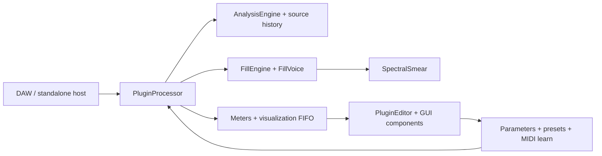

# GapFill module map

Status: as-built file map and maintenance guide, checked against `CMakeLists.txt`, public headers, repository documentation, and the source tree on 2026-10-21. This is a boundary map, not a claim that every implementation path has received a full code review. Update it whenever ownership or dependencies change.

## Runtime flow

The processor is the host boundary and coordinator. Analysis, fill scheduling, voice rendering, and UI display communicate through bounded state/events. Treat the diagram as a dependency guide; the implementation is the source of truth.

## Current source ownership

| Area | Current files | Responsibility and contract |
|---|---|---|
| Host processor / state | `Source/PluginProcessor.h/.cpp` | JUCE processor lifecycle, buses, parameter state, prepare/release, process-block/chunk orchestration, transport/PDC, bypass, preset/file state and editor-facing accessors. Keep orchestration thin; audio work is bounded and real-time safe. |
| Parameter catalog | `Source/Parameters.h/.cpp`, `Source/params/*` | `Parameters.h` holds the core IDs (`GAPFILL_PARAMS_CORE`) and chains the permanent group list; each feature group has `params/<group>.h` (X-macro IDs), `params/<group>.cpp` (layout builder + Random/Undo classification) and `tools/param_ids/<group>.lock`. IDs are public compatibility data: append only; `tools/validate_repo.py` enforces locks, spelling, uniqueness and group order. |
| Factory presets | `Source/Presets.h/.cpp` | Factory state values by parameter ID. Every referenced ID must exist and every preset must stay valid under state migration. |
| Analysis | `Source/dsp/AnalysisEngine.h/.cpp`, `Source/dsp/DspUtils.h` | Input/sidechain signal analysis and shared DSP utilities. Analysis output must be finite, bounded, and safe when the sidechain is absent or silent. |
| Source history | Owned by `PluginProcessor`; buffer implementation is in the processor/DSP sources | Bounded recent-input audio used to construct fills. Allocate/resize only in preparation paths; process callbacks must not read unwritten samples. |
| Fill scheduling / recipes | `Source/dsp/FillEngine.h/.cpp`, `SchedulerTypes.h/.cpp`, `FillRecipe.h`, `EngineSettings.h` | `trySchedule` orchestrates `checkEligibility -> rollDecision -> buildRecipe -> adjustRecipe (hook) -> toVoiceSetup -> startVoice`; every rejection carries a `RejectReason`. The legacy `Rng` draw order is frozen; features use salted sub-RNGs (`features/Salts.h`). `FillRecipe` is a 16-byte POD of the decisions taken. Decisions are reproducible and independent of host callback chunking (test: `fill_start_positions_are_independent_of_host_block_size`). |
| Fill voice | `Source/dsp/FillVoice.h/.cpp` | Renders scheduled wet fill material. Voice count and per-voice memory are bounded; protection must preserve important input transients. |
| Spectral processing | `Source/dsp/SpectralSmear.h/.cpp` | Shared spectral smear/time-frequency processing used by the fill voice. Plans and buffers are prepared before processing; CPU and memory remain bounded. |
| MIDI learn | `Source/MidiLearn.h/.cpp` | Incoming CC-to-parameter mapping, learn timeout/cancel/conflict handling, and persistence. It must not emit MIDI or block the audio callback. |
| Editor coordinator | `Source/PluginEditor.h/.cpp` | Creates panels, global actions, tabs, preset/file commands, status/latency displays, timer refresh, and editor preferences. Keep DSP decisions out of the editor. |
| Visualizer | `Source/gui/WaveformGapView.h/.cpp`, `Source/dsp/VisualisationState.h` | Reads bounded display data and paints the activity/gap view. UI sampling/painting may drop display frames; it must never affect sound. |
| Panels and controls | `Source/gui/Panels.h/.cpp`, `Source/gui/Knob.h/.cpp`, `Source/gui/LookAndFeel.h/.cpp` | Parameter-backed controls, layout, painting, accessibility labels, and theme. Components observe parameter state; they do not own audio-engine state. |
| Help / options | `Source/gui/HelpView.*`, `HelpRegistry.*`, `HelpSections.cpp`, `OptionsView.*` | `HelpView` renders whatever `HelpRegistry` holds; core text is registered in `HelpSections.cpp` (orders 100-990, 9000+), features register at 1000-8999. Options: non-automatable editor preferences. |
| Tests | `Tests/TestFramework.*`, `TestDsp.cpp`, `TestPlugin.cpp` (frozen), `TestCombinatorial.cpp`, `TestSignals.*`, `Tests/support/*`, `Tests/features/*`, `Tests/Perf.cpp`, `Tests/golden`, `Tests/fixtures` | Custom registry; `TestRig` (offline render, `drumLoop`), `AllocGuard` (per-thread allocation counter); golden renders per platform; 0.0.1 state fixtures; one `Tests/features/Test<Feature>.cpp` per feature. `GapFillTests --write-golden` / `tools/dev/write_golden.sh` rewrite baselines (only in a `[golden]` PR). |
| Build composition | `CMakeLists.txt`, `cmake/sources/*.cmake`, `cmake/tests/*.cmake`, `.github/workflows/ci.yml` | `CMakeLists.txt` is frozen: it includes one fragment per feature (explicit file lists; `file(GLOB)` only over the fragment directories). A new source file goes in the owning feature's fragment, which then applies to the plugin and the test target. |

## Ownership and thread boundaries

| Resource | Owner | Cross-thread path | Invariant |
|---|---|---|---|
| APVTS and host parameters | JUCE processor / host | JUCE parameter callbacks and atomic parameter cache | Parameter IDs and normalized/ranged conversions remain stable. Never let GUI-only preferences become automatable by accident. |
| Analysis, source history, voices | Processor and DSP engine | Audio callback only, except prepared configuration | Fixed capacity after `prepareToPlay`; no locks, allocations, file I/O, or logging in processing. |
| MIDI learn mapping | MIDI learn manager | MIDI input + bounded message-thread status updates | Mapping changes are deterministic, bounded, and serialized with plugin state. |
| Meter/visualization snapshots | Processor | Atomics/FIFO to editor timer | UI may miss frames; audio state and decisions cannot wait for the editor. |
| Preset/file chooser state | Editor/message thread | Validated state handoff to processor | File parsing is size-limited and atomic; a bad file leaves current sound unchanged. |
| Editor components | Editor/message thread | Reads snapshots and parameter attachments | Host may destroy/recreate editor at any time while audio processing continues. |

## Dependency rules

1. Dependency direction is UI → processor-facing APIs → DSP; DSP MUST NOT depend on GUI classes.
2. Prefer small data-transfer structs and explicit commands/events over direct cross-thread callbacks.
3. New feature state belongs to the feature/module that owns the behavior. Processor state is limited to routing, lifecycle, and stable integration hooks.
4. Avoid new global mutable state and circular includes. Keep registries explicit and append-only where IDs are compatibility data.
5. Add source and test files explicitly to the owning `cmake/sources/<feature>.cmake` / `cmake/tests/<feature>.cmake` fragment. Do not glob source directories.
6. Before moving code, establish behavior with a focused test and golden comparison; after moving code, run the full relevant test group and host validators.

## Current seams and refactor targets

The repository is functionally organized but still uses broad coordinator files (`PluginProcessor.cpp`, `PluginEditor.cpp`, and `Panels.cpp`). The stabilization backlog proposes narrower feature modules. Extract only when a change has a clear owner and tests:

- Split processor transport/state/preset concerns from audio callback orchestration.
- Isolate scheduler stages and recipe decisions behind the existing `FillEngine` contract.
- Keep analysis results and rejection reasons in fixed-size event records for GUI explanation.
- Add GUI panels as registered slot components instead of expanding editor conditionals.
- Keep each new effect in its own DSP module and test target; effect modules must be callable from fill recipes without introducing editor dependencies.

## Phase 0 seams (docs/dev/02-FOUNDATIONS.md, docs/dev/12 F0-10)

Each seam is a contract for later feature work. A feature adds files and edits only the rows named below; it does not edit hot files (`tools/check_hot_files.py`).

| Seam | Files | Contract / how a feature plugs in | Errors / invariants |
|---|---|---|---|
| Parameter groups | `Source/params/<group>.h/.cpp`, `tools/param_ids/<group>.lock`, `tools/param_ids/GROUP_ORDER`, `cmake/sources/params.cmake` | 41 permanent groups (core + 11 named in 02 + 30 from doc 12), all empty. Add `X (member, "id")` entries to the group header, the parameter in `add<Group>Parameters`, the id to the lock, and classify performance state in `add<Group>PerformanceIds`. | Index order = group order = permanent. IDs `^[a-z][A-Za-z0-9]*$`, unique, append-only. Defaults neutral. |
| Scheduler stages | `Source/dsp/FillEngine.cpp`, `SchedulerTypes.h` | The stage a ticket owns is edited alone: `adjustRecipe` (Lock C-5, Mistakes C-3), `buildRecipe`, `rollDecision`, `checkEligibility`. Reject with a `RejectReason` instead of `return false`. | RNG draws on `rng` frozen; new randomness via `Rng sub; sub.seed (hashCombine (ctx.key, kSalt_X))`. |
| Recipe | `Source/dsp/FillRecipe.h`, `VoiceSetup::modifierOverride/pitchOverride` | 16-byte POD with `isValid`, `toBytes/fromBytes`. A recipe flagged `flagFromLock` forces modifiers/pitch in `toVoiceSetup`. | Overrides neutral by default (0xFF / 127). |
| Queues | `Source/dsp/SpscQueue.h`, `EngineEvents.h`, `EventLogs.h`; processor `postCommand`, `drainFillEvents`, `getRecipeHistory`, `getGapOutcomeLog` | Message thread posts `Command`s (ids 1-30 permanent); `hooks::dispatchCommand` (FeatureHooks.cpp) handles them on the audio thread once per block. Audio thread pushes `FillEvent`s; the 15 Hz timer fills `RecipeHistory` (8) and `GapOutcomeLog` (64). | Single producer per queue; full `fillEvents` drops newest and counts; rejections only while the visualiser is enabled. |
| Effective settings | `Source/features/effective/Effective.*`, `Stage<Feature>.cpp`, `FeatureHooks.*` | Block stage `applyPersonality -> applyMacros`; decision stage `applyEvolve -> applyBreathing -> applyPhrase` on the scheduler's local copy. Features read their params in a `gather<Feature>` line in `FeatureHooks.cpp` and fill `EngineSettings::perf`. | Each stage is the identity at neutral settings (`memcmp` test). |
| State | `Source/features/state/StateSubtrees.*` | One row per subtree (`Macros Lock History Perf Scenes Cmd Tension Groove Fx Health Learn`) with caps (total 64 KiB): supply `validate/apply/serialise/reset`. `stateVersion` 2 written; `migrate` exists for v3. | Parameters validated atomically as before; a bad optional subtree is dropped and reset, the rest loads. Never serialise audio, momentary or preview state. |
| Editor slots | `Source/gui/SlotHost.*`, `Source/gui/slots/*.cpp` | `static SlotRegistrar` with `{Slot, order, factory}`; the host owns instances and lays them out (8 px). Reserve the slot's rectangle once in `PluginEditor::resized` (`CreativeExtra`, `VisualiserOverlay`, `FooterStatus` today). | Components receive the processor, own their attachments, never touch audio memory, survive editor re-open. |
| Help | `Source/gui/HelpRegistry.*` | `static HelpRegistrar` with order 1000-8999. | Orders unique and ascending. |
| Tooling | `tools/check_hot_files.py`, `tools/validate_repo.py`, `tools/dev/*`, `.clang-format`, `.clang-tidy` | Hot-file / golden / perf title rules; param lock rules; local gate `tools/dev/check.sh`. | CI preflight runs both Python test suites. |

Migration notes: `GAPFILL_PARAMS` is now the core list plus the group chain; the expanded macro yields the same 66 core parameters in the same order. Old (v1) states and presets load unchanged; fixtures `Tests/fixtures/state_0.0.1_*.bin` and goldens in `Tests/golden/linux` prove it.

## Change checklist

- [ ] Update the ownership table and flow diagram if a boundary moves.
- [ ] State which thread owns each new mutable object and how data crosses threads.
- [ ] Add an invariant and an error/overflow policy.
- [ ] Add focused tests before or with the extraction; include neutral-output/golden checks.
- [ ] Update `CMakeLists.txt`, developer setup and feature-to-test traceability.
- [ ] Run preflight, focused tests, full suite, plugin validators and applicable real-host checks.
